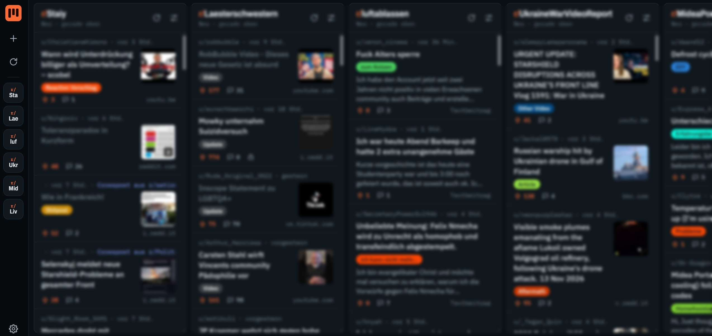

# Subdeck

Reddit wie TweetDeck: Subreddits, Suchen, Nutzer und deine Startseite nebeneinander in Spalten, die sich selbst aktualisieren. Subdeck ist eine Browser-Erweiterung ohne Server und ohne Tracking.

**Voraussetzung:** Du bist im selben Browser bei reddit.com angemeldet. Ohne Anmeldung lehnt Reddit die Abrufe ab, und die Spalten zeigen „Anmeldung nötig“.

## Firefox

Subdeck steht im Add-on-Katalog von Mozilla: <https://addons.mozilla.org/addon/subdeck-f%C3%BCr-reddit/>. Was sich in welcher Version geändert hat, steht in der [CHANGELOG.md](CHANGELOG.md).

1. Auf der Seite **Zu Firefox hinzufügen** klicken und bestätigen.
2. Subdeck über das Symbol in der Symbolleiste öffnen und oben **Zugriff erlauben** klicken. Subdeck braucht Zugriff auf `api.reddit.com` (Daten) und `www.reddit.com`.

**Aus dem Quellcode ausprobieren:** `about:debugging#/runtime/this-firefox` öffnen, **Temporäres Add-on laden …** klicken und die `manifest.json` aus diesem Ordner wählen. Ist Subdeck zusätzlich von AMO installiert, ersetzt die temporäre Fassung sie, solange sie geladen ist, denn beide haben dieselbe ID. Nach einem Neustart von Firefox ist die temporäre Erweiterung wieder weg.

## Chrome, Brave oder Edge

Subdeck ist nicht im Chrome Web Store. Du kannst es entpackt laden:

1. `chrome://extensions` öffnen (Edge: `edge://extensions`, Brave: `brave://extensions`).
2. Oben rechts den **Entwicklermodus** einschalten.
3. **Entpackte Erweiterung laden** klicken und den Subdeck-Ordner wählen, also den Ordner, in dem `manifest.json` liegt.
4. Das orange Symbol in der Erweiterungsleiste anheften. Ein Klick öffnet Subdeck in einem eigenen Tab.

Nach Änderungen an den Dateien auf der Erweiterungsseite bei Subdeck auf den Neu-laden-Pfeil klicken.

## Bedienung

- **Spalte hinzufügen:** `+` links oder die gestrichelte Kachel am Ende. Arten: Subreddit (auch mehrere, z. B. `de+germany`), Suche (ganz Reddit oder in einem Subreddit), Nutzer, Startseite. Ein eingefügter Reddit-Link wird erkannt.
- **Spalte einstellen:** Regler-Symbol im Spaltenkopf. Dort stellst du Sortierung, Zeitraum, Aktualisierungsintervall, Name und Breite ein, verschiebst die Spalte oder entfernst sie. Spalten lassen sich auch am Kopf ziehen.
- **Neue Beiträge:** Bist du oben in der Spalte, erscheinen sie direkt und sind kurz eingefärbt. Liest du weiter unten, springt nichts. Oben erscheint dann „3 neue Beiträge“. Zahlen links an den Spalten-Kürzeln zeigen Ungesehenes.
- **Beitrag lesen:** Klick öffnet rechts die Detailansicht mit Bildern, Galerie, Video und Kommentaren. Strg-Klick auf den Titel öffnet direkt Reddit.
- **Filter:** In den Einstellungen findest du NSFW, angepinnte Beiträge und stummgeschaltete Begriffe (`r/name` und `u/name` gehen auch).
- **Sichern und umziehen:** Unter Einstellungen → Spalten sichern kopierst du die Konfiguration als Text und fügst sie woanders wieder ein.

| Taste | Aktion |
| --- | --- |
| `J` / `K` | Nächster / vorheriger Beitrag (auch in der Detailansicht) |
| `H` / `L` | Spalte links / rechts |
| `Enter` / `O` | Beitrag öffnen |
| `V` | Auf Reddit öffnen |
| `1`–`9` | Zu Spalte springen |
| `N` | Spalte hinzufügen |
| `R` | Alle aktualisieren |
| `Esc` | Detailansicht schließen |

## Datenschutz

Subdeck hat keinen Server, kein eigenes Konto und kein Tracking. Dein Browser lädt die Beiträge direkt von Reddit (`api.reddit.com`) und nutzt dafür deine bestehende Reddit-Anmeldung im Browser. Subdeck sieht dein Passwort nicht und speichert nichts von deiner Sitzung. Die Schriften liegen im Paket, Subdeck lädt nichts von anderen Anbietern. Spalten, Einstellungen und der Gelesen-Verlauf liegen nur im Speicher deines Browsers.

## Grenzen

- Subdeck ist zum Lesen da. Abstimmen, Kommentieren und Posten gehen über „Auf Reddit öffnen“.
- Reddit liefert Bild und Ton getrennt aus. Subdeck setzt beides beim Abspielen zusammen. Sehr lange Videos (mehr als etwa 80 MB) laufen ohne Ton, dann steht unter dem Video ein Hinweis.
- Reddit begrenzt Anfragen ohne API-Schlüssel. Subdeck schickt höchstens etwa eine Anfrage pro Sekunde, aktualisiert standardmäßig alle 2–10 Minuten, pausiert im Hintergrund-Tab und wartet, wenn Reddit bremst. Die kleine Zahl unten links in der Leiste zeigt die freien Anfragen.
- Zeigt eine Spalte „Anmeldung nötig“, melde dich im selben Browser bei reddit.com an (Knopf **Bei Reddit anmelden**). Kehrst du danach zum Subdeck-Tab zurück, lädt er die Spalten von selbst neu.
- Reddit lässt Abrufe per Skript über `www.reddit.com/….json` inzwischen nicht mehr zu, auch mit Anmeldung nicht. Subdeck nutzt deshalb `api.reddit.com`. Ändert Reddit das wieder, kann Subdeck plötzlich nichts mehr laden.
- Mit Reddit-Anmeldung getestet ist Subdeck in Firefox. In Chrome ist geprüft, dass es lädt und die Reddit-Cookies mitsendet, ein Test mit Anmeldung steht noch aus.

## Neue Version auf AMO veröffentlichen

1. `version` in `manifest.json` erhöhen. Eine Versionsnummer lässt sich auf AMO nur einmal verwenden.
2. Die Änderungen oben in der `CHANGELOG.md` eintragen.
3. Eine ZIP bauen, in der `manifest.json` direkt oben liegt. Hinein gehören `manifest.json`, `index.html`, `app.js`, `app.css`, `popup.html`, `popup.js`, `README.md` und die Ordner `icons` und `fonts`. Die Pfade in der ZIP müssen `/` verwenden, nicht `\`.
4. Die ZIP über <https://addons.mozilla.org/developers/addon/3121666/versions/submit/> hochladen. Das ist **Neue Version hochladen** bei Subdeck. „Ein neues Add-on einreichen“ bricht mit „Doppelte Add-on-ID“ ab. Die Frage nach Quellcode mit **Nein** beantworten, denn der Code ist nicht minifiziert. Die Hinweise der automatischen Prüfung zu `innerHTML` darfst du ignorieren.
5. Committen, ein Tag `vX.Y.Z` setzen und auf GitHub ein Release mit den Einträgen aus der `CHANGELOG.md` anlegen.

## Lizenz

Subdeck steht unter der [Mozilla Public License 2.0](LICENSE). Die Schriften im Ordner `fonts` (Archivo, IBM Plex Sans, IBM Plex Mono) stehen unter der SIL Open Font License 1.1, die Lizenztexte liegen daneben (`fonts/OFL-*.txt`).
